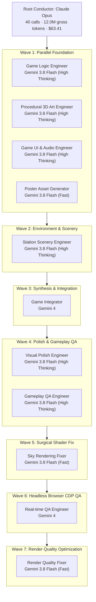
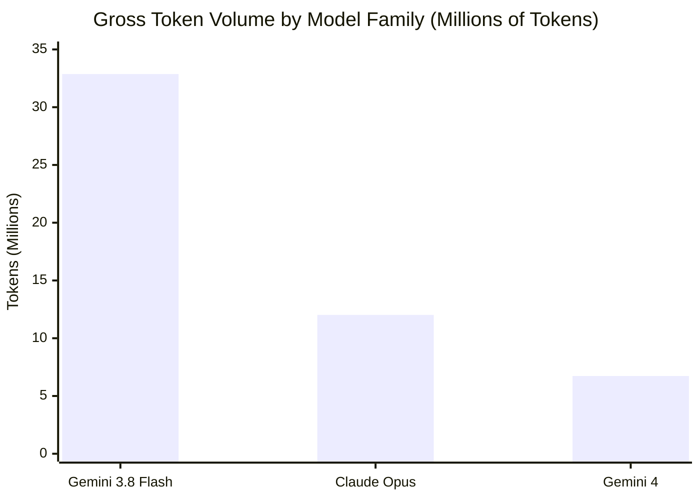

# Multi-Agent Engineering Architecture & Cost Analysis: 3D Browser Game Case Study

## Executive Summary

* **Project:** "Super Kudla Express" — a full 3D first-person browser platformer built with Three.js (custom physics, procedural textures, procedural 3D models, synthesized Web Audio, and automated browser test suites).
* **Wall-Clock Duration:** 2 hours, 8 minutes, 48 seconds.
* **Orchestration Pattern:** Hierarchical conductor-worker pattern using a high-reasoning conductor (Claude Opus) delegating execution to 11 specialized subagents (Gemini 4 and Gemini 3.8 Flash) across 7 execution waves.
* **Total Execution Volume:** 932 steps, 344 model API calls, 51.6 million gross tokens.
* **Prompt Caching Efficiency:** 88.5% cache hit ratio across the fleet (44.4 million cached prompt tokens read).
* **Total Commercial API Cost:** **$68.91** (using standard public Google Cloud Vertex AI and Anthropic API list rates).

---

## Architecture & Delegation Workflow

The workflow separates high-level architectural judgment and arbitration from high-volume implementation, file writing, asset generation, and test execution.



---

## Agent & Subagent Breakdown

### 1. Root Conductor
* **Model:** Claude Opus
* **Invocations:** 40 turns
* **Token Breakdown:**
  * Uncached Input: 1,984,414 tokens
  * Cached Input (Cache Read): 9,784,541 tokens (83.1% cache hit ratio)
  * Output: 252,794 tokens
  * Total Gross Tokens: 12,021,749 tokens
* **Responsibilities:**
  * Clarifying requirements and defining core technical scope.
  * Writing the foundational architectural contract (`DESIGN.md`) and immutable configuration constants (`src/config.js`).
  * Defining strict file boundaries (`ASSIGNED_FILES_EXCLUSIVE`) for parallel worker streams.
  * Coordinating multi-agent waves, reviewing test receipts, and managing trade-offs.

---

### 2. Specialized Worker Fleet (11 Subagents across 7 Waves)

| # | Wave | Role | Model Tier | Duration | Calls | Uncached In | Cache Read | Output | Assigned Scope & Verification |
|---|---|---|---|---|---|---|---|---|---|
| **1** | W1 | **Game Logic Engineer** | Gemini 3.8 Flash (High Thinking) | 5m 45s | 36 | 206,331 | 4,642,306 | 197,742 | `src/level.js`, `src/physics.js`. Swept 3D AABB physics, jump kinematics. 23 unit tests passed. |
| **2** | W1 | **Procedural 3D Art Engineer** | Gemini 3.8 Flash (High Thinking) | 5m 33s | 33 | 230,477 | 3,807,257 | 173,513 | `src/textures.js`, `src/models.js`. Procedural canvas textures and 3D mesh constructors. 15 smoke tests passed. |
| **3** | W1 | **Game UI & Audio Engineer** | Gemini 3.8 Flash (High Thinking) | 5m 02s | 28 | 257,127 | 2,756,469 | 138,563 | `src/audio.js`, `src/hud.js`, `src/input.js`. Web Audio synth (pentatonic raga), controls, and HUD overlay. |
| **4** | W1 | **Poster Asset Generator** | Gemini 3.8 Flash (Fast) | 2m 12s | 6 | 50,007 | 109,766 | 4,849 | `assets/posters.js`. Self-contained station signage and embedded art assets. |
| **5** | W2 | **Station Scenery Engineer** | Gemini 3.8 Flash (High Thinking) | 5m 57s | 24 | 423,848 | 4,049,082 | 183,762 | `src/scenery.js`. Railway platform, canopy columns, train models, and terrain backdrops. |
| **6** | W3 | **Game Integrator** | Gemini 4 | 16m 22s | 18 | 294,230 | 3,102,574 | 101,946 | `src/game.js`, `src/main.js`, `index.html`. Assembled game loop, camera modes, and state transitions. |
| **7** | W4 | **Visual Polish Engineer** | Gemini 3.8 Flash (High Thinking) | 5m 38s | 30 | 547,084 | 5,753,602 | 172,937 | Visual hierarchy, decor collision spacing, and ambient lighting passes. |
| **8** | W4 | **Gameplay QA Engineer** | Gemini 3.8 Flash (High Thinking) | 3m 37s | 34 | 250,391 | 4,007,269 | 79,083 | Automated play runner. Verified win/loss states; brought suite to 51 passing tests. |
| **9** | W5 | **Sky Rendering Fixer** | Gemini 3.8 Flash (Fast) | 3m 36s | 49 | 289,272 | 3,156,905 | 10,189 | Surgical shader fix: custom vertex-color gradient on the sky dome geometry. |
| **10** | W6 | **Real-time QA Engineer** | Gemini 4 | 20m 34s | 15 | 1,070,491 | 2,035,809 | 129,245 | Automated headless Chrome testing over Chrome DevTools Protocol (CDP); fixed third-person camera clipping. |
| **11** | W7 | **Render Quality Fixer** | Gemini 3.8 Flash (Fast) | 2m 36s | 31 | 154,303 | 1,209,014 | 5,477 | Optimized software-rendering flags (`?lowfx=1`) for headless runners while preserving full desktop GPU visuals. |

---

## Token Telemetry & Volume Rollup

| Aggregation Tier | Role | Invocations | Uncached Input | Cache Read | Output | Gross Tokens | Cache Hit % |
|---|---|---|---|---|---|---|---|
| **Claude Opus** | Architecture & Coordination | 40 | 1,984,414 | 9,784,541 | 252,794 | 12,021,749 | 83.1% |
| **Gemini 3.8 Flash (High Thinking)** | Core Implementation & QA | 185 | 1,915,258 | 25,015,985 | 945,600 | 27,876,843 | 92.9% |
| **Gemini 3.8 Flash (Fast)** | Surgical Fixes & Assets | 86 | 493,582 | 4,475,685 | 20,515 | 4,989,782 | 90.1% |
| **Gemini 4** | Deep Integration & Protocol QA | 33 | 1,364,721 | 5,138,383 | 231,191 | 6,734,295 | 79.0% |
| **Total Fleet** | **12 Agents Total** | **344** | **5,757,975** | **44,414,594** | **1,450,100** | **51,622,669** | **88.5%** |

---

### Token Usage Breakdown Across Models

```
               Token Volume Share by Model Family (51.6M Gross Tokens)
               =======================================================
```

<div align="center">

<svg viewBox="0 0 680 340" width="100%" height="340" xmlns="http://www.w3.org/2000/svg" style="font-family: -apple-system, BlinkMacSystemFont, 'Segoe UI', Roboto, Helvetica, Arial, sans-serif; background: transparent;">
  <!-- Slices -->
  <g>
    <!-- Gemini 3.8 Flash (63.7%) -->
    <path d="M 180 170 L 180.00 45.00 A 125 125 0 1 1 85.37 251.68 Z" fill="#1A73E8" stroke="#ffffff" stroke-width="2"/>
    <!-- Claude Opus (23.3%) -->
    <path d="M 180 170 L 85.37 251.68 A 125 125 0 0 1 88.64 84.69 Z" fill="#D97706" stroke="#ffffff" stroke-width="2"/>
    <!-- Gemini 4 (13.0%) -->
    <path d="M 180 170 L 88.64 84.69 A 125 125 0 0 1 180.00 45.00 Z" fill="#1E8E3E" stroke="#ffffff" stroke-width="2"/>
  </g>

  <!-- Slice Percentage Badges -->
  <text x="248" y="206" fill="#ffffff" font-size="14" font-weight="700" text-anchor="middle">63.7%</text>
  <text x="105" y="174" fill="#ffffff" font-size="14" font-weight="700" text-anchor="middle">23.3%</text>
  <text x="150" y="106" fill="#ffffff" font-size="13" font-weight="700" text-anchor="middle">13.0%</text>

  <!-- Legend Card -->
  <g transform="translate(350, 45)">
    <text x="0" y="20" font-size="16" font-weight="700" fill="currentColor">Token Distribution</text>
    <text x="0" y="38" font-size="12" fill="#6B7280">Total: 51,622,669 gross tokens</text>

    <!-- Item 1: Gemini 3.8 Flash -->
    <rect x="0" y="62" width="16" height="16" rx="3" fill="#1A73E8"/>
    <text x="26" y="75" font-size="13" font-weight="600" fill="currentColor">Gemini 3.8 Flash</text>
    <text x="26" y="92" font-size="12" fill="#6B7280">32,866,625 tokens (63.7%) · 271 calls</text>

    <!-- Item 2: Claude Opus -->
    <rect x="0" y="117" width="16" height="16" rx="3" fill="#D97706"/>
    <text x="26" y="130" font-size="13" font-weight="600" fill="currentColor">Claude Opus</text>
    <text x="26" y="147" font-size="12" fill="#6B7280">12,021,749 tokens (23.3%) · 40 calls</text>

    <!-- Item 3: Gemini 4 -->
    <rect x="0" y="172" width="16" height="16" rx="3" fill="#1E8E3E"/>
    <text x="26" y="185" font-size="13" font-weight="600" fill="currentColor">Gemini 4</text>
    <text x="26" y="202" font-size="12" fill="#6B7280">6,734,295 tokens (13.0%) · 33 calls</text>

    <!-- Divider & Callout -->
    <line x1="0" y1="222" x2="300" y2="222" stroke="#E5E7EB" stroke-width="1"/>
    <text x="0" y="244" font-size="11" fill="#6B7280">Conductor handles 23.3% of tokens; workers handle 76.7%</text>
  </g>
</svg>

</div>



---

## Commercial Cost Modeling

All calculations reflect standard public enterprise list pricing (Google Cloud Vertex AI and Anthropic API):

### Public Rate Cards (per 1 Million Tokens)

* **Claude Opus:** $15.00 Input · $1.50 Cache Read (90% discount) · $75.00 Output
* **Gemini 3.8 Flash:** $0.075 Input · $0.01875 Cache Read (75% discount) · $0.30 Output
* **Gemini 4:** $1.25 Input · $0.3125 Cache Read (75% discount) · $5.00 Output

### Cost Breakdown by Component

| Component | Calls | Gross Tokens | Input Cost | Cache Read Cost | Output Cost | Total Cost | % of Total |
|---|---|---|---|---|---|---|---|
| **Claude Opus (Conductor)** | 40 | 12.0M | $29.77 | $14.68 | $18.96 | **$63.41** | **92.0%** |
| **Gemini 3.8 Flash (High Thinking)** | 185 | 27.9M | $0.14 | $0.47 | $0.28 | **$0.89** | **1.3%** |
| **Gemini 3.8 Flash (Fast)** | 86 | 5.0M | $0.04 | $0.08 | $0.01 | **$0.13** | **0.2%** |
| **Gemini 4 (Integrator & QA)** | 33 | 6.7M | $1.71 | $1.61 | $1.16 | **$4.48** | **6.5%** |
| **Total Commercial API Cost** | **344** | **51.6M** | **$31.66** | **$16.84** | **$20.41** | **$68.91** | **100.0%** |

---

## Key Economic & Architectural Takeaways

### 1. The Conductor-Worker Economic Asymmetry
* The conductor handled **11.6%** of model calls (40 of 344) and **23.3%** of token volume, but accounted for **92.0%** of total dollar spend ($63.41).
* High-reasoning models provide critical framing, interface definitions, and arbitration, but running all 344 steps through the conductor would have increased the total bill to approximately **$300+**.
* Delegating 304 execution steps to Gemini models delivered the remaining **76.7%** of the token workload for just **$5.50**.

### 2. The Multiplier Effect of Prompt Caching
* Across the run, **44.4 million tokens (88.5% of input)** were served directly from context cache.
* Without prompt caching, the uncached input reprocessing bill on Claude Opus alone would have been **$176.53** instead of $44.45 (saving over **$132** on conductor input alone).
* For the Gemini fleet, prompt caching allowed large workspace contexts (full codebases and design contracts) to be passed into every worker step while keeping the entire subagent fleet cost under $6.

### 3. Wave Structure Eliminates File Conflicts
* In Wave 1, four independent workers ran in parallel on isolated files (logic, 3D meshes, UI/audio, and posters) without lock contention or merge collisions.
* Wave 3 isolated all cross-module integration into a single Gemini 4 worker.
* Surgical fixes (Waves 5 and 7) assigned single files with zero-decision instructions, achieving fast convergence in under 4 minutes each at negligible cost (<$0.15 per wave).
